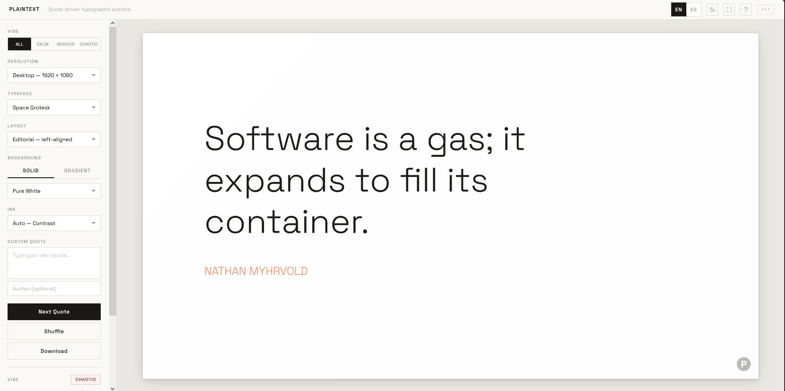

# Plaintext

**Typography-driven wallpaper generator.** Turn curated quotes — or your own words — into minimal, Swiss-inspired posters.

[](https://mendiak.github.io/plaintext/)
[](https://github.com/Mendiak/plaintext/actions/workflows/seo.yml)
[](./LICENSE)
[](./main.js)



**[→ Open Plaintext](https://mendiak.github.io/plaintext/)** · [Español](https://mendiak.github.io/plaintext/es/)

## Overview

Plaintext is a minimalist web app for lovers of typography and literature. It composes quotes into high-quality posters and wallpapers using layouts inspired by Swiss design and modernist principles, and exports them ready for desktop, mobile, Instagram and social previews.

Everything runs in the browser: no framework, no build step, no runtime dependencies.

- **238 curated quotes** across 3 vibes — Calm (72), Serious (107), Chaotic (59) — in **English and Spanish** (218 unique lines)
- **16 typefaces** picked for weight and character
- **3 layouts**, 8 paper colors plus auto-contrast ink
- **7 export formats**, from mobile to 4K

## Features

- **Curated quotes**: 238 hand-picked lines in both English and Spanish, tagged by vibe.
- **Custom quotes**: type your own text and get a personalized poster.
- **Typography focus**: 10 Google Fonts chosen for their professional weight and character.
- **Backgrounds & patterns**: solid paper tones or five gradient families, with optional typographic, grid, dot, diagonal or halftone overlays.
- **Ink control**: automatic contrast selection or manual override (ghost white, steel grey, deep black).
- **Flexible layouts**: Editorial (Swiss-style), Ruled (grid-based) or Offset (asymmetric).
- **Bilingual**: instant toggle between English and Spanish, including the static pages.
- **Zen mode** (`Z`): hide the UI and focus entirely on the composition.
- **Dark mode**: a sleek, dark interface for comfortable creative sessions.
- **Export everywhere**: desktop, 2K, 4K, ultrawide, mobile, Instagram and OG/Twitter PNGs, each with a discreet credit — the logo in one corner and `mendiak.github.io/plaintext` in the other.

## Keyboard shortcuts

The app is built for speed:

| Key | Action |
| --- | --- |
| `Space` | Generate a new quote |
| `S` | Shuffle all styles (typeface, layout, background, pattern) |
| `D` | Download the wallpaper |
| `Z` | Toggle Zen mode |
| `1` `2` `3` | Switch layouts |
| `?` | Toggle the shortcuts panel |
| `Esc` | Exit Zen mode or close panels |

## Backgrounds & styles

- **Color palettes**: curated solids (White, Cream, Ivory, Sand, Clay, Slate, Charcoal, Black) or eight fixed gradients (Paper, Sky, Mint, Blush, Sand, Stone, Night, Forest), plus Auto (by vibe). The Random action recomposes the selected gradient with a new orientation and stop distribution, using the same palette. Every swatch always renders the exact gradient the canvas will use.
- **Pattern overlays**: typographic (the quote's own letters, oversized and rotated), grid, dots, diagonal lines or halftone. Deterministic per quote, so a wallpaper always renders the same way.
- **Ink**: auto-contrast or manual override, in four tones.
- **Formats**: 1920×1080, 2560×1440, 3840×2160, 3440×1440 (ultrawide), 1080×1920 (mobile), 1080×1080 (Instagram) and 1200×630 (OG/Twitter).

## Tech

- **HTML5 Canvas** — native rendering for sharp typography and pattern overlays.
- **Vanilla JavaScript** — ES modules, zero dependencies.
- **CSS3** — fluid layout with Grid and Flexbox, no framework.
- **GitHub Pages** — static hosting straight from `main`.

## Getting started

The app itself is static, so any HTTP server works:

```bash
git clone https://github.com/Mendiak/plaintext.git
cd plaintext
python -m http.server 8000   # or: npx serve .
```

Then open <http://localhost:8000>. Opening `index.html` directly from disk will not work, because the app uses ES modules.

### Regenerating the static pages

The indexable quote pages are generated from `data/quotes.json`:

```bash
node generate.js   # Node 20+
```

`generate.js` writes `quote/<slug>/`, `es/quote/<slug>/`, the `quotes/` indexes, the About pages, `es/`, `sitemap.xml` and `robots.txt`. CI runs it on every push to `main` and commits the result, so usually you do not need to run it by hand.

## Project structure

```text
.
├── index.html            # App shell (EN)
├── main.js               # App logic: rendering, state, keyboard, export
├── style.css             # UI styles
├── utils/
│   ├── canvas.js         # Draw helpers
│   ├── random.js         # Seeded-ish random utilities
│   └── styles.js         # Typefaces, layouts, palettes, gradients
├── data/quotes.json      # 238 quotes (text, text_es, author, vibe)
├── generate.js           # Static page / sitemap generator
├── assets/               # Preview and OG images, shared quote CSS
├── quote/ · es/quote/    # Generated quote pages (do not edit by hand)
├── quotes/ · es/quotes/  # Generated indexes
├── about/ · es/about/    # Generated About pages
├── es/                   # Spanish home
└── .github/workflows/    # CI that regenerates the SEO pages
```

## Static pages & SEO

Every unique quote is published as an indexable, bilingual page with canonical URLs, `hreflang` alternates, Open Graph and JSON-LD metadata:

- `/quote/<slug>/` and `/es/quote/<slug>/` — one page per unique quote (218 per language)
- `/quotes/` and `/es/quotes/` — browsable indexes
- `/about/` and `/es/about/` — about pages
- `/es/` — Spanish home
- `/sitemap.xml` and `/robots.txt` — generated from the same source

## License

GNU General Public License v3.0 — see [LICENSE](./LICENSE) for details.

---

*Less is more. Typography as art.*
